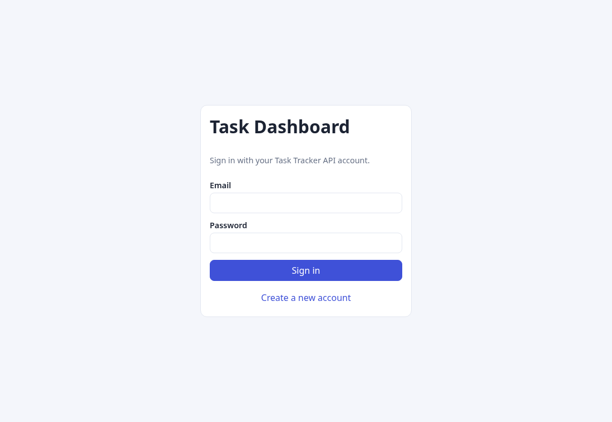
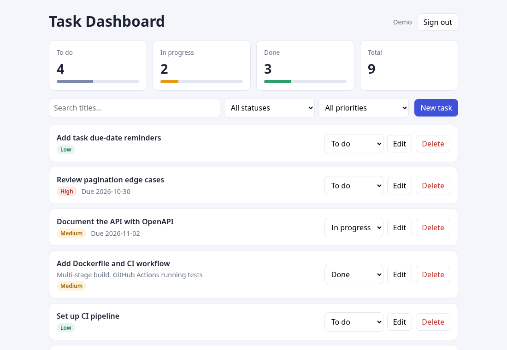
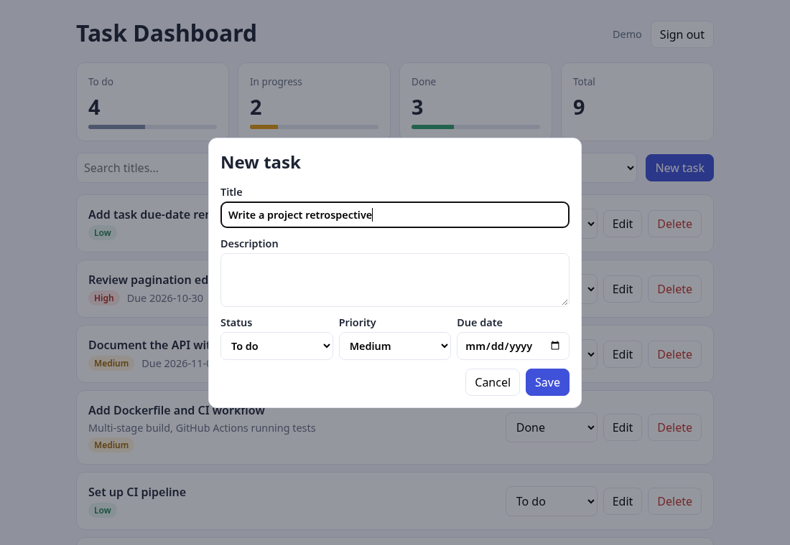
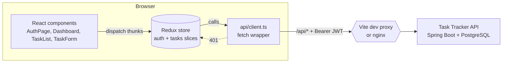

# Task Dashboard UI

[](https://github.com/prernareddym/task-dashboard-ui/actions/workflows/ci.yml)


A React + TypeScript dashboard for the [Task Tracker API](https://github.com/prernareddym/task-tracker-api): sign in, see task counts per status, search and filter tasks, and create, edit, update or delete them.

> **Personal portfolio / learning project.** I built it to practice a typed React front end with Redux Toolkit and component testing. It is not a production application, has no real users, and is not related to any employer's work.

| Sign in | Dashboard | New task |
| --- | --- | --- |
|  |  |  |

*Screenshots were captured from this UI running locally against the API with sample data.*

## Features

- Register and sign in (JWT from the API, stored in `localStorage`; automatic sign-out on a `401`)
- Summary cards with per-status counts and progress bars
- Server-side filtering by status and priority, debounced title search, pagination
- Create / edit in an accessible dialog with client-side validation; change status inline; delete with confirmation
- Loading, empty and error states; responsive layout

## Tech stack

React 19 · TypeScript (strict) · Redux Toolkit (async thunks) · Vite · Jest · React Testing Library · ESLint · Docker (nginx) · GitHub Actions

## Architecture



- `src/api` is a small typed `fetch` client that attaches the token and turns the API's RFC 7807 errors into an `ApiError`. It is configured once in `main.tsx`, so it never imports the store.
- `src/store` holds an `auth` slice (session persistence) and a `tasks` slice (items, filters, paging, summary).
- Components are presentational where possible; `Dashboard` coordinates the data flow.
- The browser only talks to same-origin `/api`, which the Vite dev server or nginx proxies to the backend, so no CORS setup is needed.

## Running it

You need the backend running first.

### Option 1: dev server

```bash
# 1. start the API (see its README), e.g. from a clone of task-tracker-api:
#    docker compose up --build        # serves http://localhost:8080

# 2. start the UI
npm install
npm run dev                            # http://localhost:5173
```

Use a different backend with `API_URL=http://host:port npm run dev`.

### Option 2: whole stack in Docker

```bash
docker compose up --build              # UI at http://localhost:3000
```

This builds the API from its GitHub repository, starts PostgreSQL, and serves the UI through nginx.

## Scripts

| Command | What it does |
| --- | --- |
| `npm run dev` | Vite dev server with `/api` proxy |
| `npm run build` | Type-check and production build |
| `npm run lint` | ESLint |
| `npm run typecheck` | `tsc --noEmit` |
| `npm test` | Jest + React Testing Library |
| `npm run test:ci` | Same, with coverage |

## Tests

34 tests across 7 suites, about 94% line coverage:

- **API client**: bearer header, query-string building, RFC 7807 error mapping, 401 handling, 204 responses
- **Redux slices**: login/register/logout, session persistence, filter-to-query mapping, page reset on filter change, error states
- **Components**: sign-in and registration flows, form validation and pre-fill, dashboard data loading, empty/error states, debounced search, create, inline status change, confirmed delete, pagination, sign-out

CI (GitHub Actions) runs lint, type-check, tests with coverage, the production build and a Docker image build.

## Known limitations

- The token is kept in `localStorage` for simplicity. A hardened app would use short-lived tokens with refresh in `HttpOnly` cookies.
- No routing library, no optimistic updates and no end-to-end browser tests; the focus is on typed state management and unit/component tests.
